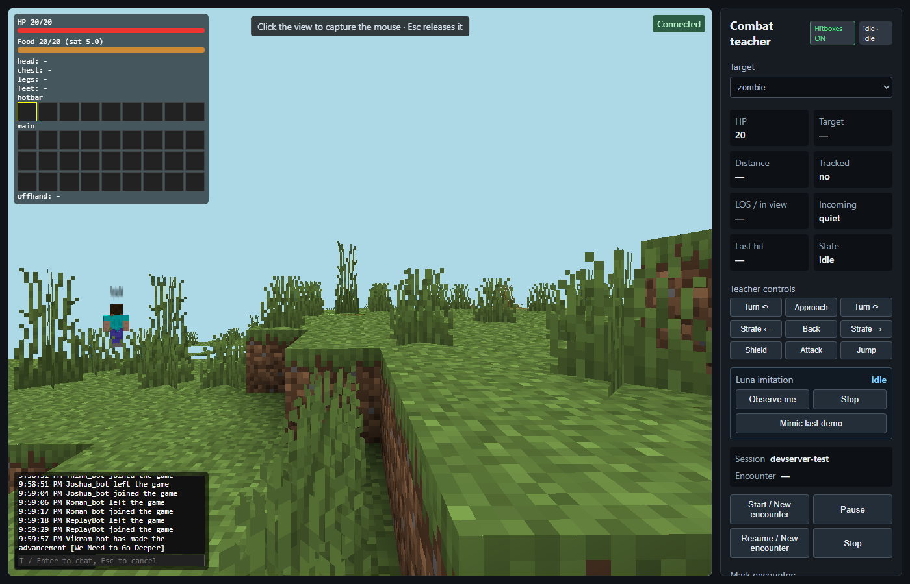
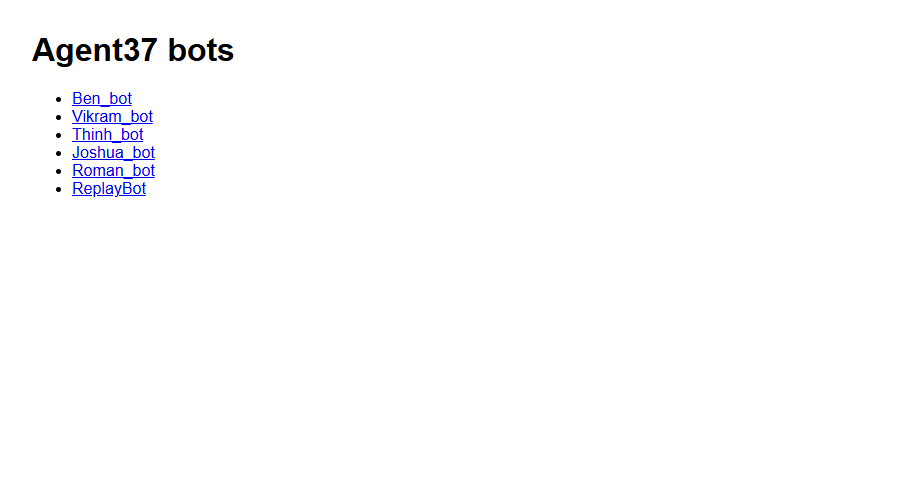

# Bridge tools

Run Agent-37 combat-bridge bots on the dev server, one per teammate, and share them through one password-protected page.

The bridge itself lives in Agent-37 (`bridge/server.js`). These tools wrap it without changing it.

## Screenshots

The control page: first-person view, HUD (health, food, armor, inventory) top-left, chat bottom-left.

The proxy's index of team bots.

Press T or Enter to chat as the bot.

## What's here

- `run-agent37-bridge.mjs` starts one bridge bot. It adds:
  - sprint while W is held, so there's no Ctrl+W
  - mouse look at 1.3x, with pitch kept between straight up and straight down
  - left click attacks the entity under the crosshair, and holding it digs blocks
  - hops up 1-block steps
  - skips Agent-37's ledge guard while a person drives (combat skills keep it)
- `status.mjs` serves `/status` (health, food, armor, inventory, chat) and `/chat`, plus the HUD. The HUD shows on the direct control page (http://localhost:<control port>) and through the proxy.
- `share-viewer.mjs` is the proxy on 127.0.0.1:8800. It serves `/` (a list of bots) and `/<path>/` for each bot's control page, viewer and status. Each bot gets its own login.
- `team.json` lists the bots and their ports.
- `start-team.ps1` and `stop-team.ps1` start or stop every bot and the proxy. If a bot gets kicked, it restarts after 10 s.
- `replay.mjs` replays a recorded combat log. `stats.mjs` summarizes logs. `bus.mjs` lets bots message each other.

## Setup (Windows)

1. Install Agent-37's bridge (`cd bridge`, then `npm install`).
2. In this folder, run `npm install`.
3. Copy `bridge.env.example` to `bridge.env` and set `A37_BRIDGE_SERVER`.
4. Copy `share-viewer.env.example` to `share-viewer.env` and set the passwords.
5. Add each bot name in `team.json` to the server whitelist, then run `/whitelist reload` in game.
6. Run `powershell -ExecutionPolicy Bypass -File .\start-team.ps1`.

To share outside the PC, point a tunnel at `http://127.0.0.1:8800`, for example `cloudflared tunnel --url http://127.0.0.1:8800`. Only give each teammate their own login.

## Creative/Survival toggle

Each bot's control page shows the bot's current mode and a **Switch to creative / Switch to survival** button.

- **Host setup:** enable RCON in the Minecraft server's `server.properties` (`enable-rcon=true`, a strong `rcon.password`), then set `A37_SERVER_DIR` in `bridge.env` to the server folder. Or set `A37_RCON_HOST` / `A37_RCON_PORT` / `A37_RCON_PASSWORD` directly. Never commit the password.
- **Off by default:** with no RCON settings, the button is greyed out with "Host has not enabled mode switching".
- **Safety:** the button only ever changes that page's own bot (the bridge uses its own username, never one sent from the browser), only to creative or survival, at most once every 3 seconds. The RCON password stays on the host and never reaches the browser.

## Notes

- If two people drive the same bot, they override each other.
- Anyone with a bot's login can drive it and chat as it.
- `*.env`, `logs/` and `bridge-data/` are git-ignored.
